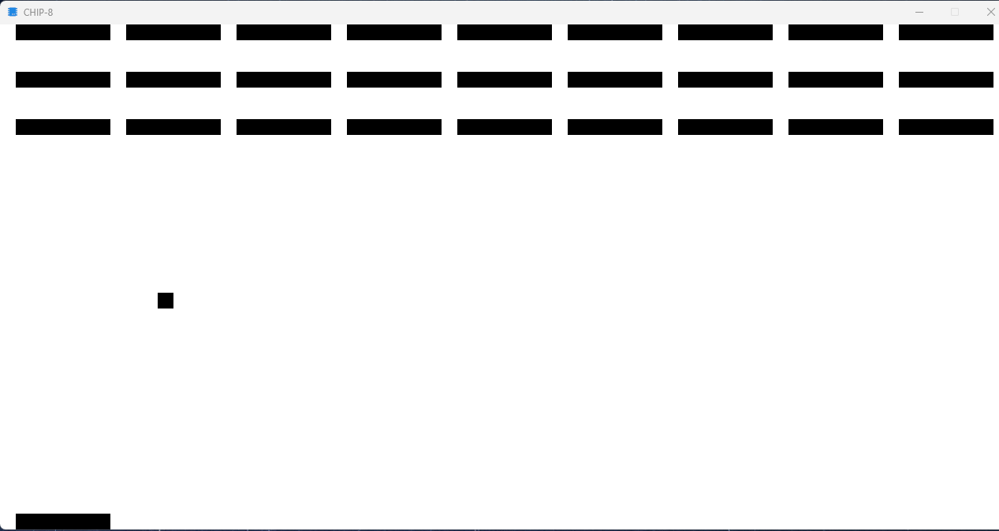

# CHIP-8

> **NOTE**: 🚧 Under active development. 🚧

Simple [CHIP-8](https://en.wikipedia.org/wiki/CHIP-8) emulator written in C, with a custom assembly language.

## Table of Contents

* [Key concepts](#key-concepts)
* [Dependencies](#dependencies)
* [IDE Integration](#ide-integration)
* [License](#license)

## Key concepts

1. Programming in binary is quite complex, therefor we provide an assembly language
2. The assembly language should stay close to the opcode's actual representation in memory

## Dependencies

The emulator has the following dependencies

* [SDL 2.0](https://github.com/libsdl-org/SDL) a cross-platform development library designed to provide low level access to audio, keyboard, mouse, joystick, and graphics hardware.

SDL2 is looked up with `find_package(SDL2)` (e.g. `libsdl2-dev` on Debian/Ubuntu, `sdl2` on Homebrew, `sdl2` via vcpkg).
If no installed SDL2 is found, it is downloaded and built automatically.

## IDE Integration

There is a plugin for vim and neovim. Another alternative is to use my own text editor YATE that has built in language support.

## License

This project is licensed under the [GNU General Public License](LICENSE)
